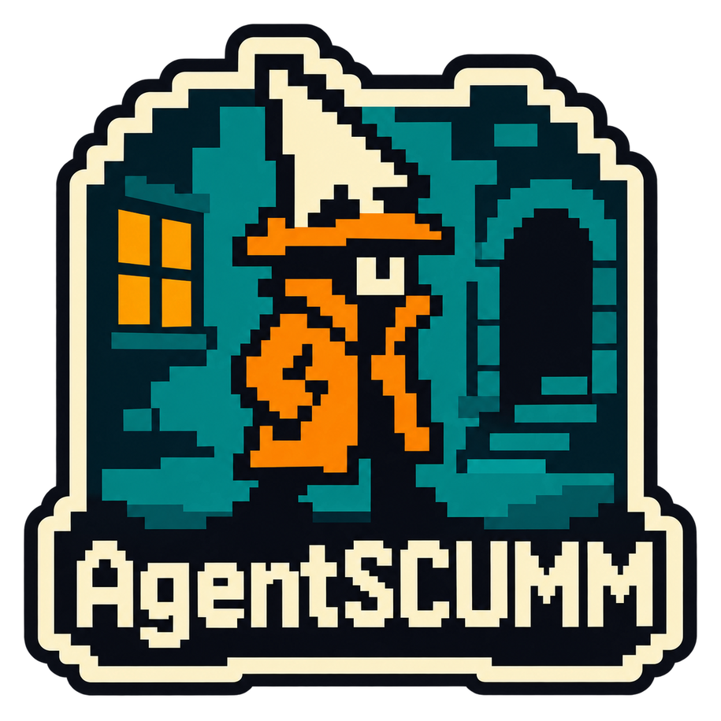

<p align="center">
  
  <br />
  <!-- repo-tagline:start -->
  <strong>🕹️ An AI agent harness for solving classic point-and-click adventures 🧭</strong>
  <!-- repo-tagline:end -->
</p>

# AgentSCUMM

AgentSCUMM lets Codex play adventure games hosted by ScummWEB through
ScummBench MCP. Codex handles puzzle solving and keeps notes between sessions.

## Quick start

Requires **Node.js 22+**, **pnpm 10**, and a graphical desktop. On macOS, also install Xcode Command Line Tools (`xcode-select --install`) for the native spectator.

Install the editable [ScummBench](https://github.com/tsilva/scummbench) checkout first with `uv tool install --editable /path/to/scummbench --exclude-newer "7 days"`. Every AgentSCUMM launch requires ScummBench and an installed ScummWEB checkout. The dependency direction is AgentSCUMM → ScummBench MCP → ScummWEB backbone. Sibling checkouts resolve automatically; other layouts set `SCUMMWEB_DIR`. See [backbone setup](../scummweb/docs/agent-backbone.md).

From the repository root:


```sh
pnpm install --frozen-lockfile
pnpm browser:install
codex mcp add agentscumm -- node "$PWD/src/index.js"
```

Start a game only after the mediation check reports `status.scummbench.mediated: true`.
See [current benchmark results](https://github.com/tsilva/scummbench/blob/main/BENCHMARKS.md)
and [gameplay and spectator controls](docs/usage.md).

[Read the agentscumm setup and gameplay guide](docs/agentscumm-guide.md) for the full reference.
