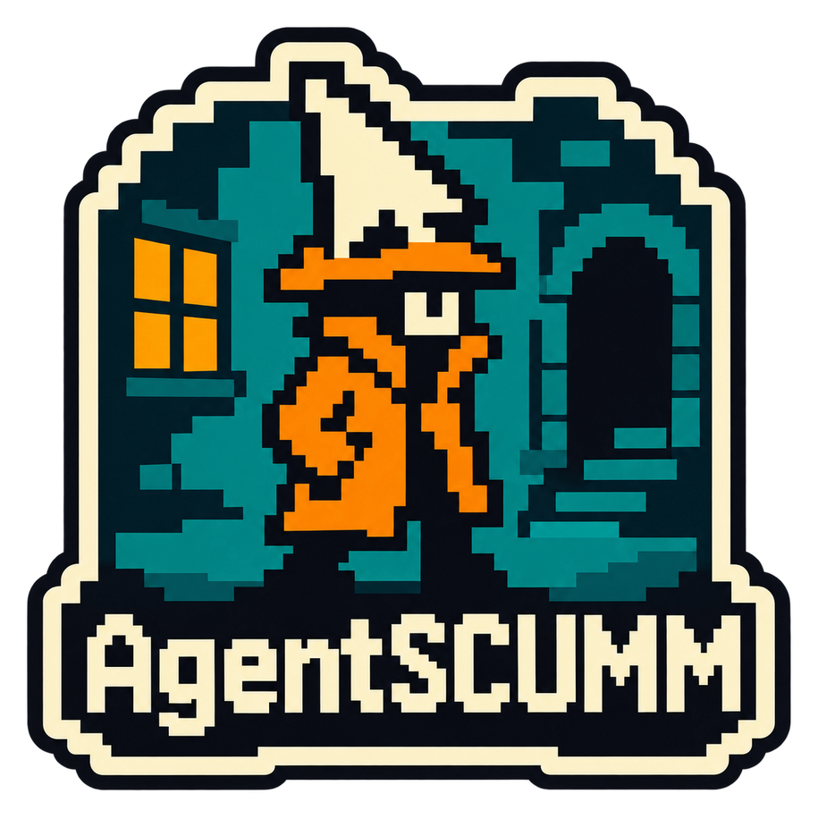

<p align="center">
  
  <br />
  <!-- repo-tagline:start -->
  <strong>🕹️ An AI agent harness for solving classic point-and-click adventures 🧭</strong>
  <!-- repo-tagline:end -->
</p>

# AgentSCUMM

AgentSCUMM lets Codex play classic adventure games running on [ScummWEB](https://scummweb.tsilva.eu). Its local MCP server gives the agent screenshots, reliable input controls, and recent visual history, while you follow along in a separate spectator window.

Codex handles puzzle solving and keeps notes between sessions. The server supplies the game interface; no separate model API key or agent framework is required.

**[See the benchmarks and recorded progress →](BENCHMARKS.md)**

## Quick start

Requires **Node.js 22+**, **pnpm 10**, and a graphical desktop. On macOS, also install Xcode Command Line Tools (`xcode-select --install`) for the native spectator.

From the repository root:

```sh
pnpm install --frozen-lockfile
pnpm browser:install
codex mcp add agentscumm -- node "$PWD/src/index.js"
```

Open a new Codex chat in this repository with the MCP enabled, then ask:

```text
$agentscumm_play-game Flight of the Amazon Queen
```

The game loads, a read-only spectator opens, and Codex starts playing toward the ending. You can request a milestone, pause, or resume a saved run. Closing the spectator leaves the game running; closing the MCP server ends the active session. Recovery depends on saves made inside the game.

The first macOS spectator launch builds its native app automatically. For setup alternatives, global skill installation, and troubleshooting, see [usage and controls](docs/usage.md).

## What it does

- **Observe and act:** inspect screenshots, issue clicks and keys, and review recent frames when an animation or dialogue is missed.
- **Follow the game:** watch a separate spectator that cannot send inputs or change the agent's screenshot coordinates.
- **Preserve progress:** keep free-form memory and evidence, then queue a verified run archive and local benchmark entry after confirmed completion.

Walkthroughs are allowed unless you request unaided play. A finished tool call does not establish puzzle success; game completion requires visible ending evidence.

## Results

The first recorded full-game completion is a **walkthrough-assisted Flight of the Amazon Queen** playthrough. [BENCHMARKS.md](BENCHMARKS.md) records its outcome, model, token usage, actions, elapsed time, and comparison limits. It is a development result, not a success-rate estimate.

## Guides

- [Usage and controls](docs/usage.md): MCP tools, action sequences, spectator setup, saves, and recovery.
- [Run archives](docs/run-archives.md): exporting and verifying trajectories, screenshots, skill copies, and `run.json` metadata.
- [Agent context and automatic finalization](docs/run-context.md): startup tools, injected assets, provenance, and export status.
- [Development and verification](docs/development.md): checks, tests, source layout, and dependency policy.
- [Price Thread skill](.agents/skills/agentscumm_price-thread/SKILL.md): estimate a recorded conversation's hypothetical API token cost.
